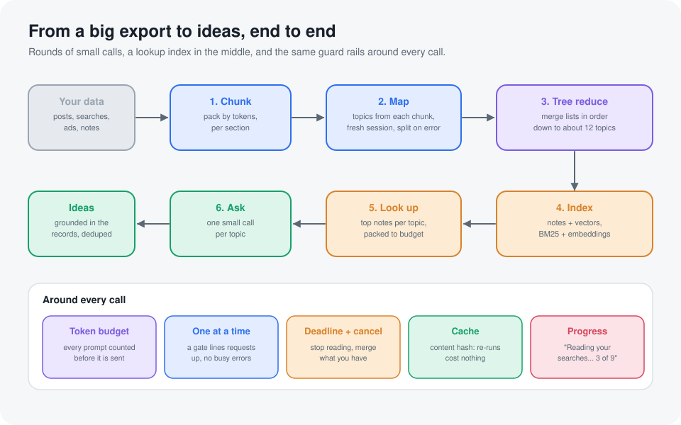
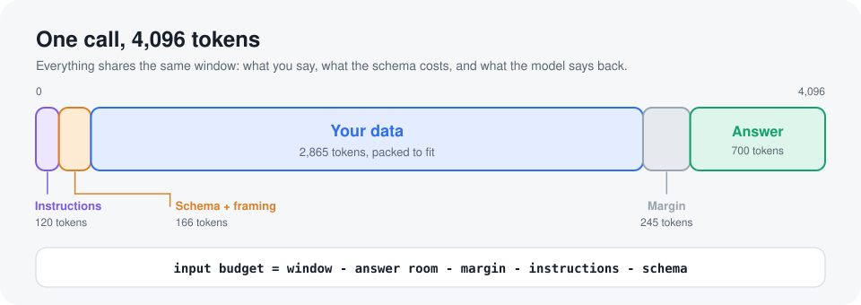
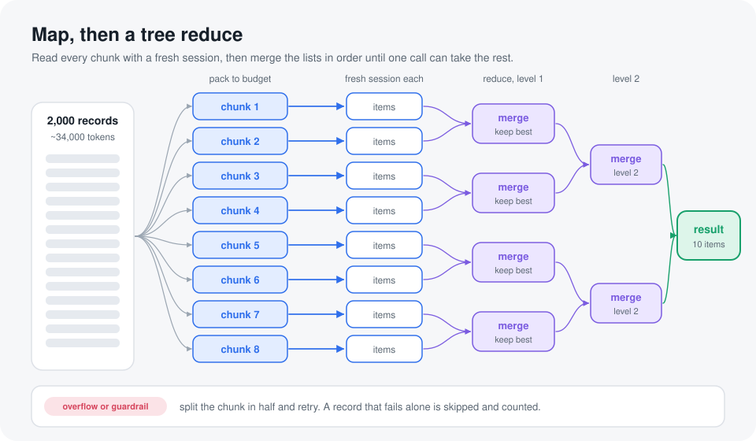
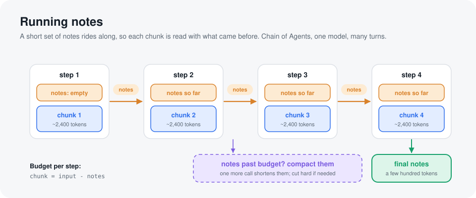
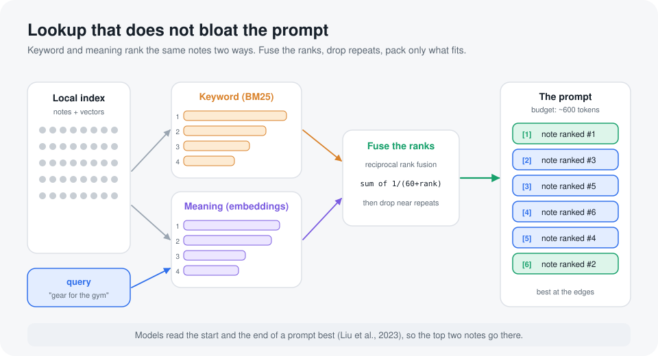

<h1 align="center">Gleaner</h1>

<p align="center">
  <b>Make Apple's small on-device model effective on a lot of personal data.</b><br>
  Token budgets, chunking, map-reduce, running notes, a local search index, caching and guard rails for the 4,096-token Foundation Models window.
</p>

<p align="center">
  
  
  
  
</p>

<picture>
  <source media="(prefers-color-scheme: dark)" srcset="docs/pipeline-dark.svg">
  
</picture>

## The problem

Apple Intelligence gives your app a free, private, on-device language model. It also gives you a context window of
**4,096 tokens**, shared by your instructions, your data, the schema of the type you want back, and the answer. That is
about three pages of text.

Personal data does not fit. A modest social media export, a year of search history or a few thousand notes is tens of
thousands of tokens. Paste it in and you get an overflow error. Truncate it and the model only ever sees the newest few
percent, so anything rare or old is invisible to it.

Gleaner is the layer in between. It reads *everything*, in many small calls, and gives your app something short and
structured back, with the bookkeeping a long run needs: budgets, deadlines, retries, caching, progress.

```swift
import Gleaner

let gleaner = Gleaner()                                    // Apple's on-device model
let result = try await gleaner.extract(Ideas.self, from: records, goal: "Find gift ideas this person would love.")
print(result.items)                                        // [Idea], every record read
```

No dependencies beyond Apple frameworks. iOS 26 and macOS 26. Swift 6 with strict concurrency.

## How it works

### 1. Every call has a token budget

The window is split before anything is sent. Gleaner measures instructions and schema with the model's own
`tokenCount(for:)` (iOS and macOS 26.4 and later, an estimate before that), reserves room for the answer, keeps a
margin, and packs your records into what is left.

<picture>
  <source media="(prefers-color-scheme: dark)" srcset="docs/token-budget-dark.svg">
  
</picture>

Counting every record exactly would cost about 45 ms each, so records are sized with an estimate calibrated against a
sample, and each finished prompt is then counted exactly once. If a prompt is still too big, it is split and retried
rather than sent.

### 2. Map, then a tree reduce

For a pile of independent records (liked posts, searches, ad captions), each chunk is read with a **fresh session** so no
history eats the window. The partial lists are then merged, in order, in groups that fit the budget, level by level,
until one call can take what is left. If a call overflows or trips a guardrail, the chunk is halved and retried; a record
that fails alone is skipped and counted, never silently lost.

<picture>
  <source media="(prefers-color-scheme: dark)" srcset="docs/map-reduce-tree-dark.svg">
  
</picture>

Later **rounds** read the data again with shifted chunk boundaries and a short "already found" list, so they hunt for
what the first round missed. That is how rare interests get noticed.

### 3. Running notes, when order matters

Some questions build on what came before. The running-notes pass keeps a short block of notes with a hard budget. Each
step sees the notes plus one new chunk and writes the updated notes; notes that outgrow their budget are compacted.

<picture>
  <source media="(prefers-color-scheme: dark)" srcset="docs/running-notes-dark.svg">
  
</picture>

### 4. Lookup that does not bloat the prompt

For questions over a big pile, do not read everything again. Put the notes in a local index. A query is ranked two ways,
by keywords (BM25) and by meaning (Apple's sentence embeddings), the ranks are fused, near-duplicates dropped, and only
what fits the budget goes in the prompt. The best note goes first and the second best last, because models read the
ends of a prompt better than the middle.

<picture>
  <source media="(prefers-color-scheme: dark)" srcset="docs/retrieval-packing-dark.svg">
  
</picture>

Everything runs on device. Nothing is sent anywhere.

## Quick start

Add the package:

```swift
.package(url: "https://github.com/YOUR-ORG/Gleaner.git", from: "0.1.0")
```

**Extract structured items from a big export**

```swift
let gleaner = Gleaner()
let result = try await gleaner.extract(
    Ideas.self,                                   // a @Generable type, built in or your own
    from: searches,                               // [String], any length
    goal: "Find gift ideas this person would love.",
    options: ExtractOptions(label: "Reading your searches", deadline: .seconds(120), passes: 2, reduceTo: 10,
                            progress: { print($0.label, $0.completed, "of", $0.total) })
)
result.items            // [Idea]
result.report           // calls, tokens, cache hits, split retries, skipped records, seconds
result.coverage         // 1.0 unless the deadline cut reading short
```

**Read several sections, then merge**

```swift
var topics: [Topic] = []
for (label, records) in [("Reading your likes", likes), ("Reading your searches", searches)] {
    topics += try await gleaner.extract(Topics.self, from: records, goal: "List this person's interests.",
                                        options: ExtractOptions(label: label, reduceTo: 10)).items
}
let merged = try await gleaner.merge(Topics.self, topics, to: 12, goal: "List this person's interests.")
```

**Ask questions over a pile of notes (retrieval)**

```swift
let index = NoteIndex()                           // Apple's sentence embeddings + BM25
await index.add(notes)                            // [String]; add(_, id:, metadata:) to tag them
let answer = try await gleaner.ask("What does she do with film cameras?", over: index)
answer.text; answer.sources                       // the notes that were put in the prompt
```

**Summarize hierarchically**

```swift
let summary = try await gleaner.summarize(records, goal: "Summarize what this person writes about.")
```

**Running notes (order matters)**

```swift
let notes = try await gleaner.runningNotes(records, goal: "Track how the plan changes.")
notes.text; notes.trail                           // the final notes, and the notes after every step
```

**Your own output type**

```swift
@Generable struct Brand: LineRenderable {
    @Guide(description: "The brand's name") var name: String
    @Guide(description: "What it sells, a few words") var sells: String
    var line: String { "\(name): \(sells)" }
}
@Generable struct Brands: BatchOutput {
    @Guide(description: "Brands the records mention", .maximumCount(8)) var items: [Brand]
}
let brands = try await gleaner.extract(Brands.self, from: records, goal: "List the brands mentioned.")
```

**Another model**

Implement `SmallModel` (a name, a `contextSize`, and two `respond` methods; token counting is optional). Tests use the
built-in `ScriptedModel`.

## What keeps a long run safe

| | |
| --- | --- |
| **Budgets** | `Gleaner.budget(...)` returns the exact input room for a call. `TokenBudget` and `TokenEstimator` are public. |
| **Deadlines** | `deadline:` on any recipe. Reading stops when time runs low, the rest is merged, `report.deadlineHit` says so. |
| **Cancellation** | Cancel the `Task`; in-flight work stops and the call throws `CancellationError`. |
| **Back-pressure** | A first-in-first-out gate. The on-device model answers one request at a time, so concurrency is 1 by default and extra callers wait instead of failing with a busy error. |
| **Overflow and guardrails** | Split in half and retry up to six levels. Anything that still fails alone is skipped and counted in `report.skippedRecords`. |
| **Caching** | Answers are keyed by a SHA-256 of model, instructions and prompt. `MemoryCache` by default, `DiskCache` to survive relaunches, `nil` to turn it off. Greedy sampling makes the same input give the same answer, so a rerun costs nothing. |
| **Progress** | A `ProgressHandler` with your label, stage and counts: "Reading your Google searches... 3 of 9". |
| **Unavailable model** | `requireAvailable()` throws `modelUnavailable` with a readable reason (not eligible, not enabled, still downloading). |

## The API at a glance

| Type | What it is |
| --- | --- |
| `Gleaner` | The engine. `extract`, `merge`, `summarize`, `runningNotes`, `ask`, `budget`. |
| `SmallModel` | The model protocol. `FoundationModelsAdapter` (Apple) and `ScriptedModel` (tests). |
| `BatchOutput`, `LineRenderable` | What a `@Generable` list type conforms to. Built in: `Ideas`, `Topics`, `Facts`. |
| `NoteIndex` | The local hybrid index. `add`, `search`, `pack`, `snapshot()` to save, `init(snapshot:)` to load. |
| `TextEmbedder` | `SentenceEmbedder` (default), `ContextualEmbedder`, `HashingEmbedder` (no assets, for tests). |
| `Chunker`, `TokenBudget`, `TokenEstimator`, `Packing` | The pure building blocks, if you want to do your own pipeline. |
| `ExtractOptions`, `SummarizeOptions`, `NotesOptions`, `AskOptions` | Label, deadline, progress and recipe knobs. |
| `RunReport` | What a run cost. |
| `ResultCache`, `MemoryCache`, `DiskCache` | Caching. |

## A real run

Measured on a Mac with Apple Intelligence (macOS 27, Apple silicon, release build), using the demo in
`Sources/GleanerDemo`. The data is **invented**: a made-up person with 1,200 liked posts and 800 searches (about
32,600 tokens, 8 times the window), ten planted interests, three of them rare and only in the older half of the export.
The full output is in [`docs/real-run.txt`](docs/real-run.txt). Reproduce it:

```sh
swift build -c release && .build/release/gleaner-demo --deadline 1200
```

Both approaches got the same goal: "find gift ideas this person would love".

| | A. One prompt, truncated to fit | B. Gleaner |
| --- | --- | --- |
| Records read | 165 of 2,000 (the newest 8%) | 2,000 of 2,000 (29 of 29 chunks) |
| Model calls | 1 | 40 |
| Prompt tokens | 2,905 | 87,024 |
| Time | 15.6 s | 509 s (about 8.5 minutes) |
| Planted interests noticed | 2 of 10 | 7 of 10 |
| Ideas touching a real interest | 33% | 75% |
| Missed | 8 interests | board games, film photography, houseplants |

Gleaner's run: two sections (posts, searches), two rounds each, a tree merge, a local index of 614 unique records, then
one lookup and one small call per topic. The same posts run a second time took 0.09 s and 0 model calls, all answers
from cache. Retrieval questions over the raw records answered in 2 to 4 seconds with 320 to 480 prompt tokens, for
example "What does she do with film or cameras?" found the film camera post and the 35mm bulk loader search that the
truncated prompt never saw.

**Read this fairly.** Gleaner spends about 33 times the time and 30 times the tokens, and on-device that is battery and
heat, so it belongs in a background job with a deadline. Even so, the small model is a weak writer: some ideas are
generic ("Recipe book on pasta" came from a noise post), a few "why" lines stretch ("supports gardening indirectly" for
finger tape), and two interests came back twice from the merge so their ideas repeat. Gleaner makes sure the model has
*read* the data; it cannot make a 3B model wise. Validate what comes back against your own data, as you would any
model output. The first run of the same demo, with the earlier prompts and one round, found 5 of 10 (output not kept);
prompts and rounds matter as much as the plumbing.

## Performance notes

- **Speed is output-bound.** Calls with about 3,000 prompt tokens took 5 to 13 seconds depending on how much the model
  wrote. Short answers (a `maximumCount` of 6 to 12 small items) are much cheaper than prose.
- **One request at a time.** More concurrency does not speed up the on-device model. Leave `concurrency` at 1 for Apple's
  model; raise it only for a model that can use it.
- **Embedding is a one-off.** `NLEmbedding` took roughly 20 to 55 ms a note here (a release build, 614 notes in 19 to
  34 s across two runs). Build the index once, save it with `snapshot()`, and reload it. Identical notes collapse to one.
- **Read newest first.** Records are read in the order you give them, and a deadline cuts from the end, so pass newest
  first (exports usually are). `report.coverage` tells you how much was read.
- **Cache hits are free**, so repeat runs on unchanged data cost almost nothing; changing the goal or the data changes the key.
- **Instructions and schemas cost tokens** (a one-line instruction was 51, a small schema 123). Keep both short.

## Limits

- The model's windows, speed and knowledge are the limits. Do not ask it to *know* things (it is wrong about brands and
  facts); give it text and ask it to read, extract or rank.
- Items found by `extract` are what the model wrote, not guaranteed quotes. Check them against the source records.
- `reduceTo` cannot exceed the `maximumCount` of your batch type.
- The merge compares items by their text. Two items about the same thing worded differently can both survive.
- Token counts need iOS or macOS 26.4. Before that Gleaner estimates, with a safety margin, and relies on split-and-retry.
- Tested on macOS only (no simulator or iPhone was used). The code is the same on iOS, but timings will differ.
- English is the best-tested language. `SentenceEmbedder(language:)` and `ContextualEmbedder(language:)` take others.

## Research

Why it is built this way, with links: [RESEARCH.md](RESEARCH.md). The short version: Apple's own technote recommends
splitting tasks and retrieval; Chain of Agents, LLM×MapReduce, RAPTOR, ReadAgent and MemGPT show the patterns;
Lost in the Middle explains where to put things; BM25 plus embeddings fused with reciprocal rank fusion is the
dependable retrieval recipe.

## Develop

```sh
swift test                                  # 41 tests, a scripted model, no Apple Intelligence needed
GLEANER_LIVE=1 swift test --filter Live     # opt in: runs against the real on-device model
swift run -c release gleaner-demo           # the comparison above
```

The tests cover budgets, chunk sizes, reduce order, retrieval ranking, cache hits, split and retry, deadlines,
cancellation, back-pressure and progress, all against a scripted model. The live tests and the demo use the real one.

## License

MIT. See [LICENSE](LICENSE).
